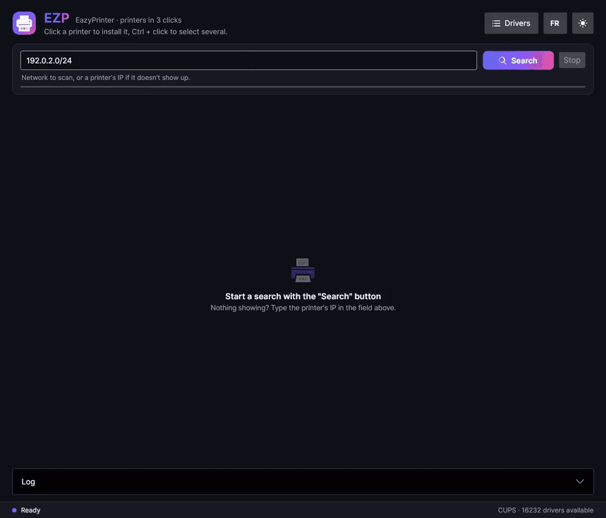

# EZP — EazyPrinter

🇬🇧 [English](README.md) · 🇫🇷 **Français**

**Installer les imprimantes réseau multimarques en 3 clics, sur Windows, Linux et macOS.**

EZP scanne le réseau, reconnaît chaque imprimante (marque, modèle, numéro de série), choisit le bon pilote et l'installe. Un seul fichier exécutable, rien à installer à côté.



<sub>Démo enregistrée avec des imprimantes simulées.</sub>

## Téléchargement

Les versions prêtes à l'emploi sont dans les [**Releases**](../../releases/latest) :

| Système | Fichier | Lancement |
|---|---|---|
| Windows 10/11 | `EZP-x.y.z-Windows.zip` | `EZP.exe` (les droits administrateur sont demandés au lancement) |
| Linux x64 (Fedora, Ubuntu, Debian…) | `EZP-x.y.z-Linux-x64.zip` | `./EZP`, ou `./installer-raccourci.sh` pour l'ajouter au menu des applications. CUPS doit être installé. |
| macOS Apple Silicon (M1/M2/M3/M4) | `EZP-x.y.z-macOS-AppleSilicon.zip` | Ouvrir `EZP.app` |
| macOS Intel | `EZP-x.y.z-macOS-Intel.zip` | Ouvrir `EZP.app` |

> **Premier lancement**
> - **Windows** : l'exe n'est pas signé. Si SmartScreen affiche « Windows a protégé votre ordinateur » → **Informations complémentaires** → **Exécuter quand même**.
> - **macOS** : clic droit → **Ouvrir**. Si macOS refuse quand même, dans le Terminal :
>   `codesign --force --deep -s - EZP.app && xattr -dr com.apple.quarantine EZP.app`

## Fonctionnalités

- **Scan du réseau** : propose tout seul la bonne plage d'adresses, interroge chaque adresse en SNMP (v2c, puis v1 en secours) et teste les ports d'impression (9100, 631, 515, 80, 443). Environ 10 secondes pour un réseau /24.
- **Identification** : marque, modèle, numéro de série et adresse MAC. Les marques revendues sous un autre nom sont rattachées à leur constructeur (UTAX → Kyocera, Develop → Konica Minolta, Nashuatec → Ricoh, Samsung → HP…).
- **Un pilote universel par marque** : PostScript d'abord, PCL seulement si aucun PostScript n'existe. Le pilote est téléchargé après le scan, une fois la marque connue.
- **Pilotes à jour tout seuls** : au démarrage, EZP vérifie les nouvelles versions et met à jour les pilotes déjà téléchargés (HTTPS, somme de contrôle SHA256 vérifiée).
- **Import manuel** : glisser-déposer d'un pilote (.zip, .exe, .inf, .msi, .ppd ou dossier) quand aucun pilote automatique n'est trouvé.
- **IP à la main** : pour une imprimante que le scan ne voit pas.
- **Installation complète** : port, pilote, recto-verso et noir et blanc par défaut, imprimante par défaut, page de test. Les doublons ajoutés tout seuls par Windows sur la même IP sont remplacés.
- **Mode clair et mode sombre.**

### Comment EZP installe selon le système

| Système | Installation | Pilotes |
|---|---|---|
| Windows | PowerShell + spouleur Windows | Universel PostScript/PCL de la marque, puis pilote du modèle sur Windows Update, puis pilote générique |
| Linux | CUPS (`lpadmin`) ; le mot de passe est demandé par la fenêtre système (pkexec) | Sans pilote (IPP Everywhere) si possible, sinon PPD du modèle (hplip, foomatic, brlaser…), sinon PostScript générique |
| macOS 11+ | CUPS (`lpadmin`) ; mot de passe administrateur du Mac | Sans pilote (AirPrint) si possible, sinon PPD installé ou importé, sinon PostScript générique |

### Marques prises en charge

HP, Canon, Kyocera, Ricoh, Konica Minolta, Xerox, Brother, Lexmark, Sharp, Toshiba, Epson, OKI, ainsi que leurs marques revendues sous un autre nom.

Canon, Ricoh, Xerox et Brother n'ont pas de lien de téléchargement direct (licence à accepter sur leur site) : EZP ouvre la page du constructeur.

## Données et réglages

EZP garde ses pilotes et réglages dans le dossier de données de l'utilisateur :

- Windows : `%LOCALAPPDATA%\EZP`
- Linux : `~/.local/share/EZP`
- macOS : `~/Library/Application Support/EZP`

**Mode clé USB** : s'il y a un dossier `Drivers` à côté de l'exécutable, tout reste sur la clé.

Fichiers utiles :
- `ezp-settings.json` : thème, scan au démarrage, nom des imprimantes, recto-verso par défaut…
- `drivers.json` : pilotes préférés par marque (expressions régulières, du plus préféré au moins préféré). Il est recréé automatiquement s'il est supprimé.

## Compiler

Prérequis : SDK .NET 8.

```sh
./build.sh          # Linux ou macOS : tests + les 4 versions dans out/*.zip
.\build.ps1         # Windows
dotnet run --project tests/EFP.Tests   # tests seuls
```

Le workflow GitHub Actions (`.github/workflows/build.yml`) compile les 4 versions sur un Mac et signe l'app macOS.

## Structure du code

```
src/EFP.Core      moteur, sans dépendance externe
  Snmp/             client SNMP v1/v2c
  Discovery/        plages IP, scan, identification
  Drivers/          lecture des INF, catalogue, choix du pilote
  Windows/          scripts PowerShell générés et exécution
  Platform/         Linux et macOS (CUPS)
  Updates/          veille et mise à jour des pilotes
src/EFP.Desktop   interface Avalonia (Windows, Linux, macOS)
tests/EFP.Tests   tests : faux agent SNMP, faux serveur de pilotes, PowerShell simulé
packaging/        fichiers Linux et macOS ajoutés aux zips
```

<sub>« EFP » est l'ancien nom du projet, gardé dans les noms internes du code.</sub>

## Limites connues

- IPv4 uniquement.
- **SNMP** : si la communauté SNMP a été changée ou désactivée, l'imprimante est trouvée via ses ports, mais sans marque ni modèle. L'ajout manuel par IP fonctionne toujours.
- **Windows, imprimante par défaut** : Windows la règle par utilisateur. Lance EZP depuis la session de l'utilisateur concerné.
- **Sources des pilotes** : certaines mises à jour passent par des paquets Chocolatey maintenus par des bénévoles, parfois quelques jours après le constructeur. Le fichier vient toujours du site officiel et sa somme de contrôle est vérifiée.

## Licence

[MIT](LICENSE) : libre d'utiliser, modifier et redistribuer, en gardant la mention de licence.

Pour publier une nouvelle version : changer `<Version>` dans `src/EFP.Desktop/EFP.Desktop.csproj`, puis pousser un tag `vX.Y.Z`. GitHub Actions compile les 4 versions et crée la Release toute seule.
