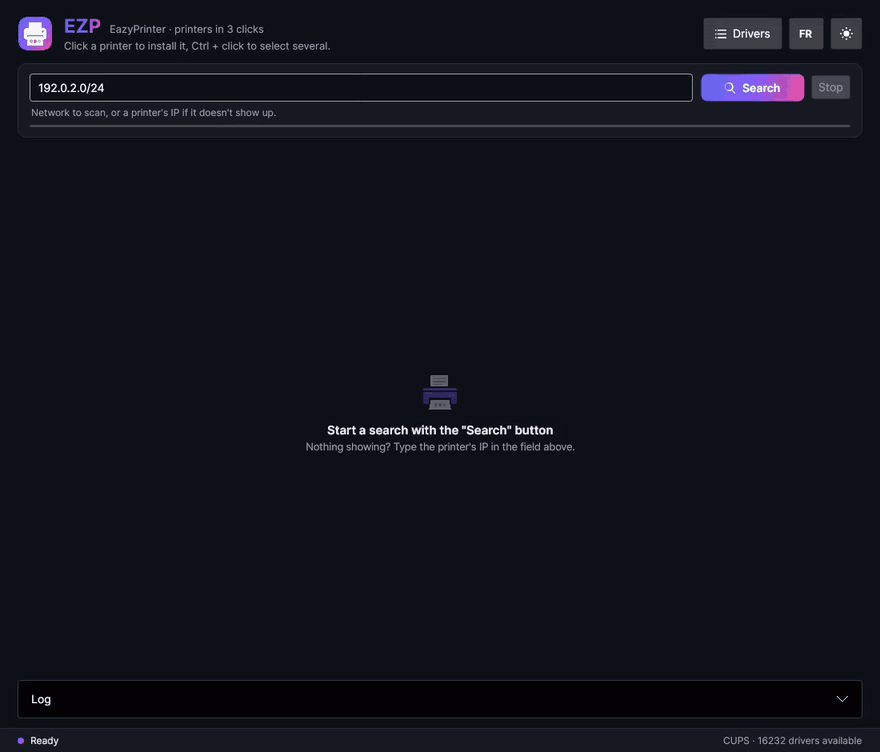

# EZP — EazyPrinter

🇬🇧 **English** · 🇫🇷 [Français](README.fr.md)

**Install multi-brand network printers in 3 clicks — on Windows, Linux and macOS.**

EZP scans the network, identifies each printer (brand, model, serial number), picks the right driver and installs it. One single executable, nothing else to install.



<sub>Demo recorded with simulated printers. The interface is currently in French; an English version is planned.</sub>

## Download

Ready-to-use builds are in the [**Releases**](../../releases/latest):

| System | File | How to run |
|---|---|---|
| Windows 10/11 | `EZP-x.y.z-Windows.zip` | `EZP.exe` (asks for administrator rights at launch) |
| Linux x64 (Fedora, Ubuntu, Debian…) | `EZP-x.y.z-Linux-x64.zip` | `./EZP`, or `./installer-raccourci.sh` to add it to the applications menu. CUPS must be installed. |
| macOS Apple Silicon (M1/M2/M3/M4) | `EZP-x.y.z-macOS-AppleSilicon.zip` | Open `EZP.app` |
| macOS Intel | `EZP-x.y.z-macOS-Intel.zip` | Open `EZP.app` |

> **First launch**
> - **Windows**: the exe is not signed. If SmartScreen shows "Windows protected your PC" → **More info** → **Run anyway**.
> - **macOS**: right-click → **Open**. If macOS still refuses, run in Terminal:
>   `codesign --force --deep -s - EZP.app && xattr -dr com.apple.quarantine EZP.app`

## Features

- **Network scan**: suggests the right address range, queries each address over SNMP (v2c, then v1 as fallback) and probes the printing ports (9100, 631, 515, 80, 443). About 10 seconds for a /24 network.
- **Identification**: brand, model, serial number and MAC address. Rebranded printers are mapped to their real manufacturer (UTAX → Kyocera, Develop → Konica Minolta, Nashuatec → Ricoh, Samsung → HP…).
- **One universal driver per brand**: PostScript first, PCL only if no PostScript driver exists. The driver is downloaded after the scan, once the brand is known.
- **Self-updating drivers**: at startup, EZP checks for new versions and updates the drivers already downloaded (HTTPS, SHA256 checksum verified).
- **Manual import**: drag and drop a driver (.zip, .exe, .inf, .msi, .ppd or a folder) when no driver is found automatically.
- **Manual IP**: for a printer the scan doesn't see.
- **Full setup**: port, driver, duplex and black & white by default, default printer, test page. Duplicates that Windows added on its own for the same IP are replaced.
- **Light and dark mode.**

### How EZP installs on each system

| System | Installation | Drivers |
|---|---|---|
| Windows | PowerShell + Windows print spooler | Brand's universal PostScript/PCL driver, then the model's driver from Windows Update, then a generic driver |
| Linux | CUPS (`lpadmin`); the password is asked by the system dialog (pkexec) | Driverless (IPP Everywhere) when possible, otherwise the model's PPD (hplip, foomatic, brlaser…), otherwise generic PostScript |
| macOS 11+ | CUPS (`lpadmin`); Mac administrator password | Driverless (AirPrint) when possible, otherwise an installed or imported PPD, otherwise generic PostScript |

### Supported brands

HP, Canon, Kyocera, Ricoh, Konica Minolta, Xerox, Brother, Lexmark, Sharp, Toshiba, Epson, OKI, and their rebranded models.

Canon, Ricoh, Xerox and Brother have no direct download link (a license must be accepted on their site): EZP opens the manufacturer's page instead.

## Data and settings

EZP stores its drivers and settings in the user's data folder:

- Windows: `%LOCALAPPDATA%\EZP`
- Linux: `~/.local/share/EZP`
- macOS: `~/Library/Application Support/EZP`

**USB stick mode**: if there is a `Drivers` folder next to the executable, everything stays on the stick.

Useful files:
- `ezp-settings.json`: theme, scan at startup, printer naming, default duplex…
- `drivers.json`: preferred drivers per brand (regular expressions, from most to least preferred). Recreated automatically if deleted.

## Build

Requirements: .NET 8 SDK.

```sh
./build.sh          # Linux or macOS: tests + the 4 builds in out/*.zip
.\build.ps1         # Windows
dotnet run --project tests/EFP.Tests   # tests only
```

The GitHub Actions workflow (`.github/workflows/build.yml`) builds all 4 versions on a Mac and signs the macOS app.

**Releasing a new version**: bump `<Version>` in `src/EFP.Desktop/EFP.Desktop.csproj`, then push to `main`. GitHub Actions builds the 4 versions and creates the `vX.Y.Z` tag and Release automatically.

## Code structure

```
src/EFP.Core      engine, no external dependencies
  Snmp/             SNMP v1/v2c client
  Discovery/        IP ranges, scan, identification
  Drivers/          INF parsing, catalog, driver selection
  Windows/          generated PowerShell scripts and execution
  Platform/         Linux and macOS (CUPS)
  Updates/          driver update checks and downloads
src/EFP.Desktop   Avalonia interface (Windows, Linux, macOS)
tests/EFP.Tests   tests: fake SNMP agent, fake driver server, simulated PowerShell
packaging/        Linux and macOS files added to the zips
```

<sub>"EFP" is the project's former name, kept in internal code names.</sub>

## Known limitations

- IPv4 only.
- **SNMP**: if the SNMP community was changed or SNMP is disabled, the printer is found through its ports but without brand or model. Adding it manually by IP still works.
- **Windows default printer**: Windows sets it per user. Run EZP from the session of the user concerned.
- **Driver sources**: some updates come from Chocolatey packages maintained by volunteers, sometimes a few days after the manufacturer. The file always comes from the official site and its checksum is verified.

## License

[MIT](LICENSE): free to use, modify and redistribute, as long as the license notice is kept.
